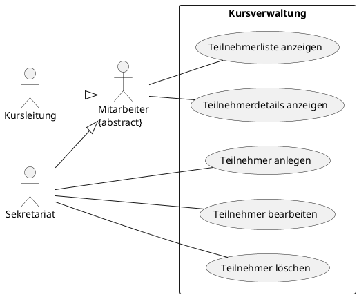
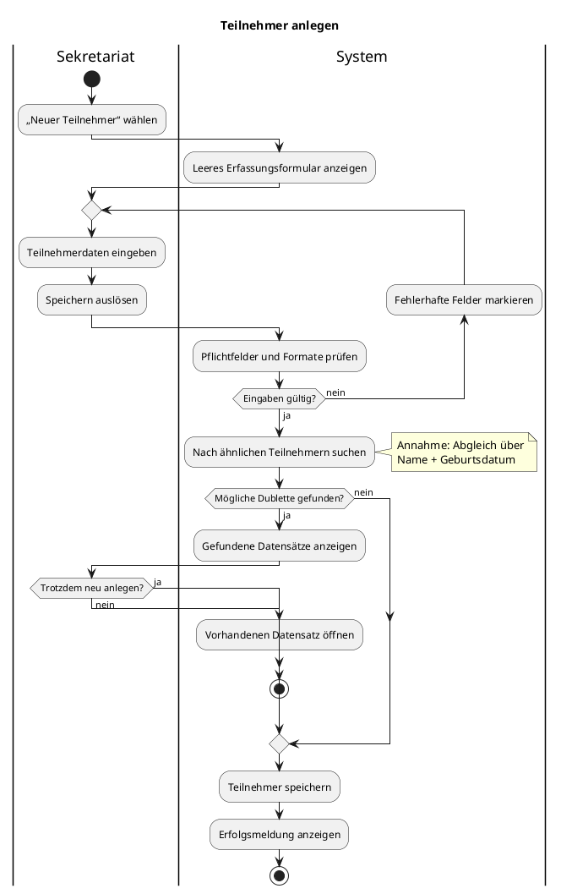
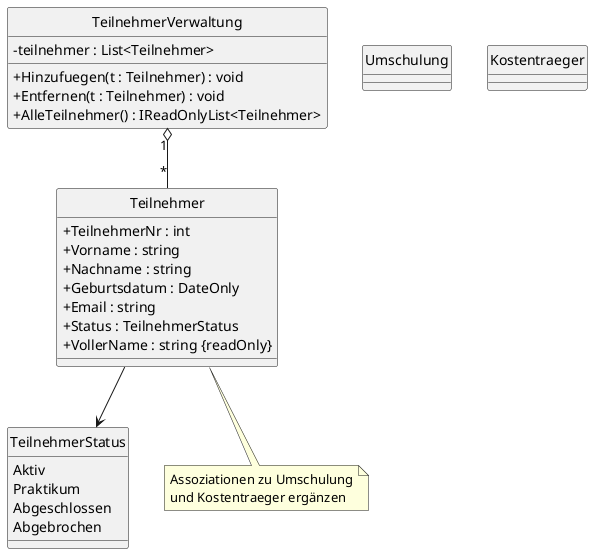

# Projektbeschreibung: Teilnehmerverwaltung

Sie arbeiten als IT-Expertin bzw. IT-Experte bei einem Softwarehaus, das Verwaltungssoftware für Bildungseinrichtungen entwickelt. Ihr Kunde ist die **„NeuStart IT-Akademie"** in Stuttgart, ein Bildungsträger für Umschulungen zur **Fachinformatikerin / zum Fachinformatiker** in den Fachrichtungen **Anwendungsentwicklung (AE)** und **Systemintegration (SI)**.

## Szenario

Bisher verwaltet das Sekretariat alle Teilnehmenden in einer einzigen Excel-Tabelle. Jede Umschulung dauert 24 Monate, und die Kosten übernimmt meist ein Kostenträger (Agentur für Arbeit, Jobcenter, Rentenversicherung …). Mit der Zeit gibt es immer mehr Probleme:

- Ändert sich der Raum eines Kurses oder die Ansprechperson eines Kostenträgers, muss das Sekretariat **viele Zeilen** anpassen. Dabei wird regelmäßig eine Zeile vergessen.
- Derselbe Kostenträger steht in **unterschiedlichen Schreibweisen** in der Liste.
- Kursleitungen möchten schnell sehen, wer in ihrem Kurs ist, ohne die ganze Datei zu durchsuchen.

Die Akademieleitung beauftragt Sie mit einer **Desktop-Anwendung** (Wpf), mit der das Sekretariat Teilnehmende anzeigen, anlegen, bearbeiten und löschen kann. Später sollen die Daten in einer Datenbank liegen. Deshalb soll das Datenmodell schon jetzt sauber entworfen werden.

## Ausgangsdaten (Auszug aus der (fiktiven) Excel-Liste)

| TN-Nr | Name | Geb.-Datum | E-Mail | Kurs-Nr | Umschulung | Beginn | Ende | Raum | Kostenträger | Ansprechpartner | Tel. Kostenträger | Status |
|---|---|---|---|---|---|---|---|---|---|---|---|---|
| 1001 | Lovelace, Ada | 14.03.1991 | ada.lovelace@example.de | FIAE-25A | Fachinformatiker/in Anwendungsentwicklung | 01.09.2025 | 31.08.2027 | 2.14 | Agentur für Arbeit Stuttgart | Frau Yilmaz | 0711 555-1200 | aktiv |
| 1002 | Martin, Robert C. | 02.11.1987 | robert.martin@example.de | FIAE-25A | Fachinformatiker/in Anwendungsentwicklung | 01.09.2025 | 31.08.2027 | 2.14 | Jobcenter Stuttgart | Herr Brandt | 0711 555-4000 | aktiv |
| 1003 | Torvalds, Linus | 27.06.1995 | l.torvalds@example.de | FISI-25A | Fachinformatiker/in Systemintegration | 01.09.2025 | 31.08.2027 | 1.08 | Agentur für Arbeit Stuttgart | Frau Yilmaz | 0711 555-1200 | Praktikum |
| 1004 | Hopper, Grace | 09.01.1984 | g.hopper@example.de | FISI-25A | Fachinformatiker/in Systemintegration | 01.09.2025 | 31.08.2027 | 1.08 | Deutsche Rentenversicherung BW | Frau Kessler | 0711 555-8480 | aktiv |
| 1005 | Beckenbauer, Franz | 21.08.1990 | franz.beckenbauer@example.de | FIAE-25A | Fachinformatiker/in Anwendungsentwicklung | 01.09.2025 | 31.08.2027 | 2.14 | Agentur f. Arbeit Stgt. | Fr. Yilmaz | 0711 555-1200 | abgebrochen |
| 1006 | Hamilton, Margaret | 30.04.1998 | margaret.hamilton@example.de | FIAE-26B | Fachinformatiker/in Anwendungsentwicklung | 02.03.2026 | 01.03.2028 | 2.15 | Jobcenter Stuttgart | Herr Brandt | 0711 555-4000 | aktiv |
| 1007 | Berners-Lee, Tim | 12.12.1993 | tim.berners-lee@example.de | FISI-25A | Fachinformatiker/in Systemintegration | 01.09.2025 | 31.08.2027 | 1.09 | Jobcenter Stuttgart | Herr Brandt | 0711 555-4000 | aktiv |
| 1008 | Hejlsberg, Anders | 05.05.1986 | a.hejlsberg@example.de | FIAE-26B | Fachinformatiker/in Anwendungsentwicklung | 02.03.2026 | 01.03.2028 | 2.15 | Berufsförderungsdienst der Bundeswehr | Herr Albrecht | 0711 555-3300 | aktiv |
| 1009 | Perlman, Radia | 18.07.1996 | radia.perlman@example.de | FISI-25A | Fachinformatiker/in Systemintegration | 01.09.2025 | 31.08.2027 | 1.08 | Agentur für Arbeit Stuttgart | Frau Yilmaz | 0711 555-1200 | Praktikum |
| 1010 | Liskov, Barbara | 23.02.1989 | barbara.liskov@example.de | FIAE-26B | Fachinformatiker/in Anwendungsentwicklung | 02.03.2026 | 01.03.2028 | 2.15 | Deutsche Rentenversicherung BW | Frau Kessler | 0711 555-8480 | aktiv |

## Anwendungsfälle

Das Use-Case-Diagramm zeigt, was die Anwendung leisten soll. Das Filtern der Liste ist eine optionale Erweiterung (siehe Optionale Erweiterungen a).

### Ablauf „Teilnehmer anlegen"

Das Aktivitätsdiagramm beschreibt den Anwendungsfall „Teilnehmer anlegen" genauer. Es zeigt, wer welchen Schritt ausführt, wann die Eingaben geprüft werden und was bei einer möglichen Dublette passiert. Nutzen Sie es als Vorlage für Aufgabe 3 (welche Rückmeldungen braucht die Oberfläche?) und für Aufgabe 4.3.

> Die **Dublettenprüfung** (ab „Nach ähnlichen Teilnehmern suchen") ist für die Abgabe optional (siehe Optionale Erweiterungen d). Der Pflichtteil endet nach der Eingabeprüfung mit dem Speichern.

---

## Aufgabe 1: ER-Modell ableiten

Die Excel-Liste ist **eine einzige große Tabelle**. Das führt zu den Problemen aus dem Szenario.

### 1.1 Analyse

Untersuchen Sie die Tabelle und beantworten Sie kurz schriftlich:

- Welche Informationen wiederholen sich in mehreren Zeilen?
- Finden Sie mindestens **zwei Unstimmigkeiten** in den Daten. Wodurch sind sie entstanden?
- Welche Spalte ist nicht **atomar** und sollte aufgeteilt werden?

### 1.2 ER-Modell

Entwerfen Sie ein **ER-Modell**, das die Redundanzen beseitigt. Grundlagen zu Entitäten, Attributen, Schlüsseln und Beziehungen finden Sie im [LinkedIn-Learning-Video zum ER-Modell](https://www.linkedin.com/learning/datenbankdesign-mit-der-mysql-workbench/das-entity-relationship-modell-er-modell).

- Bestimmen Sie die **Entitätstypen** (mindestens drei) und ihre **Attribute**.
- Kennzeichnen Sie **Primärschlüssel** und **Fremdschlüssel**.
- Geben Sie die **Beziehungen** mit **Kardinalitäten** an.
- Zeichnen Sie das ER-Modell als **ER-Diagramm** in Chen- oder Krähenfuß-Notation, z. B. mit PlantUML (`entity`), draw.io oder der MySQL Workbench aus dem Video.

> **Leitfrage:** Wie viele Teilnehmende gehören zu einer Umschulung, und zu wie vielen Umschulungen gehört ein Teilnehmender gleichzeitig?

---

## Aufgabe 2: Klassendiagramm

Übertragen Sie das ER-Modell in ein **UML-Klassendiagramm** für die C#-Anwendung. Als Ausgangspunkt ist die Klasse `Teilnehmer` vorgegeben. Ergänzen Sie die fehlenden Klassen, Attribute und Assoziationen.

> **Leitfragen:**
> - Im ER-Modell verweist ein Fremdschlüssel (z. B. `KursNr`) auf eine andere Tabelle. Wie bildet man diese Beziehung im Klassendiagramm ab?
> - In welche Richtung muss die Assoziation navigierbar sein? Braucht eine `Umschulung` eine Liste ihrer Teilnehmenden?

---

## Aufgabe 3: Wireframe

Zeichnen Sie einen **Wireframe** für das Hauptfenster, zum Beispiel mit PlantUML-Salt, Papier und Stift, *Draw.io* oder einem Tool Ihrer Wahl. Der Wireframe muss alle Pflicht-Anwendungsfälle aus dem Use-Case-Diagramm abdecken:

- eine Liste der Teilnehmenden mit den wichtigsten Angaben (z. B. Name, Kurs, Status)
- einen Bereich, in dem Sie die Daten des ausgewählten Teilnehmenden sehen und bearbeiten können
- Buttons für „Neu", „Speichern" und „Löschen"
- Auswahl von Umschulung, Kostenträger und Status über **`ComboBox`en** statt über Freitextfelder

> **Leitfrage:** Welches Problem aus der Excel-Liste verhindert eine `ComboBox` für den Kostenträger?

---

## Aufgabe 4: Umsetzung in WPF

Setzen Sie Klassendiagramm und Wireframe als WPF-Anwendung um. Die Logik darf im **Code-Behind** mit **Event-Handlern** stehen.

### 4.1 Domänenmodell und Testdaten

- Implementieren Sie die Klassen aus Aufgabe 2.
- Legen Sie die Daten aus der Tabelle beim Programmstart im Code an, z. B. in einer statischen Klasse `Testdaten`. Korrigieren Sie dabei die Unstimmigkeiten aus 1.1.
- Wie in Bits & Bites gilt: **Die Domänenklassen enthalten keinen WPF-Code.**

### 4.2 Listenansicht

- Eine `ListBox` oder ein `DataGrid` zeigt alle Teilnehmenden an.
- Verwenden Sie eine `ObservableCollection<Teilnehmer>` als `ItemsSource`.

### 4.3 Anlegen

- „Neu" leert die Eingabefelder. „Speichern" legt einen neuen Teilnehmenden an und vergibt die nächste freie Teilnehmernummer.
- **Eingaben prüfen:** Vorname, Nachname, Umschulung und Kostenträger sind Pflichtfelder, und die E-Mail muss ein `@` enthalten. Bei Fehlern erscheint eine verständliche Meldung, und es wird nichts gespeichert.
- Der Ablauf entspricht dem Aktivitätsdiagramm „Teilnehmer anlegen" bis zur Eingabeprüfung.

### 4.4 Bearbeiten

- Bei `SelectionChanged` werden die Daten des ausgewählten Teilnehmenden in die Eingabefelder übernommen.
- „Speichern" übernimmt die Änderungen in das ausgewählte Objekt. Auch hier werden die Eingaben geprüft.

> **Hinweis:** Ändern Sie eine Eigenschaft eines Objekts, das schon in der Liste steht, aktualisiert sich die Anzeige nicht von selbst. Lösungsmöglichkeiten: `LstTeilnehmer.Items.Refresh()` oder `INotifyPropertyChanged` in `Teilnehmer`.

### 4.5 Löschen

- „Löschen" entfernt den ausgewählten Teilnehmenden nach einer Sicherheitsabfrage (`MessageBox` mit Ja/Nein).
- Ist niemand ausgewählt, sind „Löschen" und das Bearbeiten deaktiviert.

### Testfälle (Systemtest)

Ein **Unit-Test** prüft eine klar abgegrenzte, kleine Softwareinheit (einzelne Klasse oder Methode) automatisiert und isoliert von der Oberfläche, z. B. `NaechsteTeilnehmerNr()`.
 Die folgenden Testfälle prüfen dagegen das **integrierte System aus Anwendersicht über die Benutzeroberfläche**; sind damit dem Systemtest bzw. End-to-End-Test zuzuordnen und in der Regel **Black-Box**-orientiert, da Eingaben und sichtbare Ergebnisse bewertet werden.

Werden solche fachlichen Tests im Rahmen der formalen Freigabe durch den Auftraggeber/Kunden durchgeführt, spricht man von **Abnahmetests**.

Für die Nachvollziehbarkeit sollten Testfälle auf Anforderungen/Anwendungsfälle oder andere Qualitätsanforderungen referenzieren.

In der **IHK-Projektdokumentation** werden diese im Abschnitt Qualitätssicherung als Testprotokoll dokumentiert: Testfall-ID, Ziel/Anforderung, Vorbedingungen, Testschritte, Soll-Ergebnis, Ist-Ergebnis, Status (bestanden/nicht bestanden), optional Datum, Tester, Version und Fehlerreferenz.

| ID | Anwendungsfall | Vorbedingung / Testschritte | Erwartetes Ergebnis | Ist-Ergebnis | bestanden? |
|---|---|---|---|---|---|
| T01 | Teilnehmerliste anzeigen | Programm starten | Liste zeigt 10 Teilnehmende, „Löschen" ist deaktiviert | | |
| T02 | Teilnehmerdetails anzeigen | Teilnehmer 1003 auswählen | Felder zeigen Linus Torvalds, FISI-25A, Status Praktikum | | |
| T03 | Teilnehmer anlegen | „Neu", Kent Beck, FIAE-26B, Jobcenter Stuttgart eingeben, „Speichern" | erscheint mit TN-Nr 1011 in der Liste | | |
| T04 | Teilnehmer anlegen | „Neu", Nachname leer lassen, „Speichern" | Fehlermeldung, Liste unverändert | | |
| T05 | Teilnehmer bearbeiten | 1007 auswählen, Status auf „Abgebrochen" setzen, „Speichern" | Liste zeigt den neuen Status sofort an | | |
| T06 | Teilnehmer löschen | 1005 auswählen, „Löschen", Abfrage mit „Nein" beantworten | 1005 bleibt in der Liste | | |
| T07 | Teilnehmer löschen | 1005 auswählen, „Löschen", Abfrage mit „Ja" beantworten | 1005 ist entfernt, „Löschen" wieder deaktiviert | | |

---

## Optionale Erweiterungen

### a) Filter

- Eine Such-`TextBox` filtert die Liste nach Namen (Groß-/Kleinschreibung egal).
- Zusätzlich lässt sich über `ComboBox`en nach Umschulung und Status filtern, z. B. „alle Teilnehmenden im Praktikum".
- Tipp: `CollectionViewSource.GetDefaultView(...)` mit `Filter` und `Refresh()`

### b) DataBinding

Die Eingabefelder werden nicht mehr im Code-Behind befüllt und ausgelesen, sondern per `{Binding}` an den ausgewählten Teilnehmenden gebunden (`DataContext` bzw. `SelectedItem`). Welche Zeilen im Code-Behind entfallen dadurch?

### c) MVVM

Bauen Sie die Anwendung nach dem MVVM-Muster um:

- `TeilnehmerlisteViewModel` mit `ObservableCollection<Teilnehmer> Teilnehmer`, `Teilnehmer? AusgewaehlterTeilnehmer`, `ICommand NeuCommand`, `SpeichernCommand` und `LoeschenCommand`
- „Löschen" ist nur ausführbar, wenn jemand ausgewählt ist. Das regelt `CanExecute`.
- Das Code-Behind des Fensters enthält nur noch das Setzen des `DataContext`.

### d) Dublettenprüfung

Setzen Sie den zweiten Teil des Aktivitätsdiagramms „Teilnehmer anlegen" um:

- Vor dem Speichern sucht die Anwendung nach Teilnehmenden mit **gleichem Vor- und Nachnamen und gleichem Geburtsdatum**.
- Gibt es einen Treffer, zeigt sie ihn an und fragt, ob trotzdem neu angelegt werden soll. Bei „Nein" wird der vorhandene Datensatz in der Liste ausgewählt.
- Die Suche gehört in die `TeilnehmerVerwaltung`, nicht in das Fenster.

---

## Abgabebedingungen

- **Frist:** Montag, 26.10.2026, 8:00 Uhr
- **Format:** Lösung als ZIP-Archiv einreichen (ohne `bin`- und `obj`-Ordner)
- **Namensschema:** `Nachname-Vorname-Teilnehmerverwaltung.zip` (z. B. `Mueller-Florian-Teilnehmerverwaltung.zip`)
- **Inhalt:**
  - Visual-Studio-Projektmappe mit der WPF-Anwendung
  - Ordner `doc/` mit den Antworten zu 1.1, dem ER-Modell, dem Klassendiagramm (`.puml` oder Bild), dem Wireframe (`.puml`, Bild oder Foto einer Skizze) und dem ausgefüllten Testprotokoll
- **Pflichtumfang:** Aufgaben 1 bis 4. Die optionalen Erweiterungen sind freiwillig. Geben Sie in einer kurzen `README.md` an, welche Sie umgesetzt haben.
- **Portfolio:** Das Projekt kann zusätzlich im persönlichen GitHub-Repository veröffentlicht werden.
